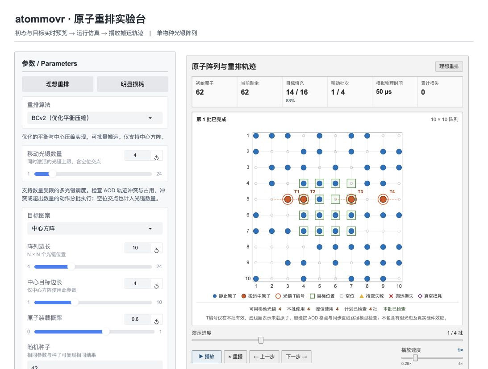

# atommovr 中文原子重排实验台

[](CHANGELOG.md)
[](https://www.python.org/)
[](LICENSE)

面向教学、演示和算法初步比较的本地交互网页。它调用官方 `atommovr` 仿真库，展示单物种光镊阵列的原子重排过程。

[English edition / 英文版](https://github.com/aa3277105147-create/atommovr-ui-en) 在独立仓库维护。

公开在线版直接运行本仓库原有的 Gradio 界面，不另建一套网页。Render 与 Hugging Face Space 的部署步骤见[在线部署说明](在线部署说明.md)。

[](https://render.com/deploy?repo=https://github.com/aa3277105147-create/atommovr-ui-zh)



## 主要功能

- 六种原生算法：Parallel Hungarian、Hungarian、Parallel LBAP、Generalized Balance、BCv2 和 Balance & Compact。
- 中心方阵、棋盘格、横条纹和竖条纹目标；支持随机装载及手动布置初态。
- 1—24 束移动光镊的数量上限、完整 AOD 交点计数和保守避碰调度。
- 光镊速度、阵列间距、原子寿命、拾取／放下成功率及操作时间参数。
- 播放、暂停、重播、单步、进度拖动和 0.25×—4× 动画速度。
- 同一初态的算法对照、多种子统计、结果 JSON 和逐次 CSV 导出。

## 快速启动

所有系统均需安装 [Git](https://git-scm.com/) 和 Python 3.11 或更高版本，然后下载或克隆本仓库。

### Windows

双击 `start.bat`，或在命令提示符中运行：

```bat
start.bat
```

### Linux

在仓库目录运行：

```bash
chmod +x start.sh
./start.sh
```

### macOS

双击 `启动交互界面.command`，也可以运行：

```bash
./start.sh
```

首次启动会准备依赖，所需时间取决于网络和电脑配置。各平台脚本按以下顺序寻找 atommovr：

1. 环境变量 `ATOMMOVR_SOURCE` 指向的完整源码目录；
2. `~/Downloads/atommovr-main`；
3. 自动下载到本仓库 `.deps/atommovr`。

如需指定解释器，可将环境变量 `ATOMMOVR_PYTHON` 设为 Python 3.11+ 的可执行文件路径。

浏览器会打开本机地址，通常为 <http://127.0.0.1:7860>。终端窗口保持打开即表示服务正在运行；在终端中按 `Control-C` 可停止。

## 手动安装

官方源码必须保留完整目录，Parallel LBAP 会使用顶层 `PPSU2023` 组件。托管下载与参考版本固定到 atommovr 提交 `cca2553985bb9d81b19cae9b83074df4816502f9`；通过 `ATOMMOVR_SOURCE` 指定或在 Downloads 中自动发现的现有源码可能使用不同提交，复现实验时应另行记录。

```bash
git clone https://github.com/bernienlab/atommovr.git
git -C atommovr checkout cca2553985bb9d81b19cae9b83074df4816502f9

python3.11 -m venv .venv
.venv/bin/python -m pip install -r requirements.txt
.venv/bin/python -m pip install -e ./atommovr

ATOMMOVR_SOURCE="$PWD/atommovr" .venv/bin/python app.py
```

Windows PowerShell 使用 `.venv\Scripts\python.exe`，并在启动前执行：

```powershell
$env:ATOMMOVR_SOURCE = (Resolve-Path .\atommovr)
.venv\Scripts\python.exe app.py
```

Parallel LBAP 第一次运行时可能需要本机 C 编译器来构建平台对应的动态库。其他算法不需要主动运行该构建步骤。

## 使用说明

打开页面后，参数变化会立即更新初态与目标预览；点击“运行仿真”才会生成新的轨迹。光镊数量表示一批中允许激活的完整 AOD 交点上限，并不保证每批都使用到该数量。

详细内容见：

- [使用说明](使用说明.md)
- [算法说明与比较口径](算法说明.md)
- [功能审查与扩展取舍](功能审查与取舍.md)
- [验证记录](验证记录.md)

## 验证

发布前已运行 62 项 Python 行为测试，并检查播放器 JavaScript 与启动脚本语法。

```bash
PYTHONDONTWRITEBYTECODE=1 .venv/bin/python -m unittest discover -s . -p 'test_*.py' -v
node --check player.js
zsh -n 启动交互界面.command
bash -n start.sh
```

## 模型边界

避碰检查基于格点、同步直线路径和点状光阱模型，不等同于真实设备的完整波形、有限光斑、拍频、功率与加热仿真。算法对照和少量种子统计用于演示和复核具体场景，不应直接解释为算法的普遍性能排名。

## 创作范围、上游项目与引用

本项目实现的新增部分包括参数界面、Canvas 播放器、仿真数据适配、数量受限的保守调度、算法对照与统计、导出和跨平台启动工具。可以将这些部分表述为“基于 atommovr 开发的交互界面与适配层”；不应据此主张上游算法、物理模型或标准匹配与轨迹检查方法的原创性。

六种重排算法、原子阵列模型、误差模型和核心物理计时来自 [bernienlab/atommovr](https://github.com/bernienlab/atommovr)，不能声明为本项目原创。本仓库不属于 atommovr 官方项目，也不捆绑其源码；启动程序会下载或读取独立副本。atommovr 作者为 Nikhil K. Harle、Bo-Yu Chen、Bob Bao 和 Hannes Bernien，采用 MIT License。

如本演示或其核心仿真对研究有帮助，请引用：

> N. K. Harle, B.-Y. Chen, B. Bao, and H. Bernien, “atommovr: An open-source simulation framework for rearrangement in atomic arrays,” *Quantum* **10**, 2177 (2026). [https://doi.org/10.22331/q-2026-07-29-2177](https://doi.org/10.22331/q-2026-07-29-2177)

第三方来源和许可关系见 [THIRD_PARTY_NOTICES.md](THIRD_PARTY_NOTICES.md)。本界面与适配层以 [MIT License](LICENSE) 发布。
